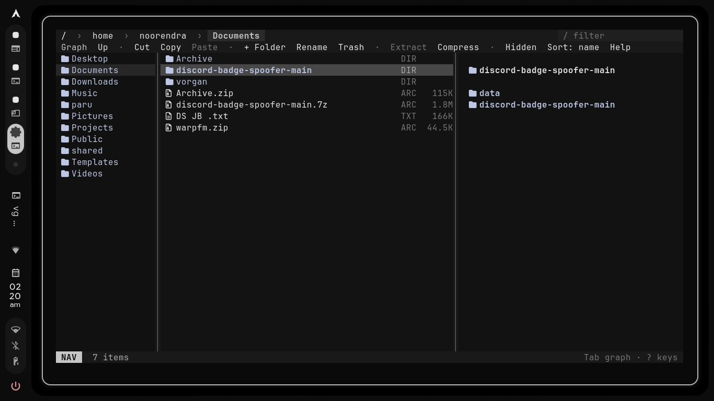
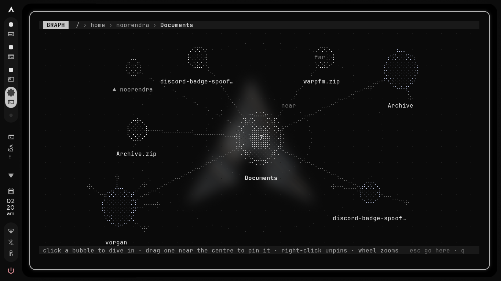
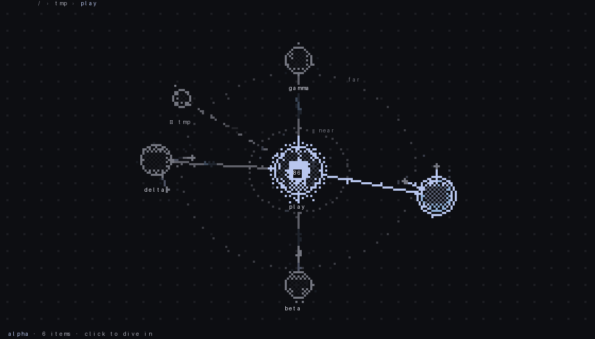
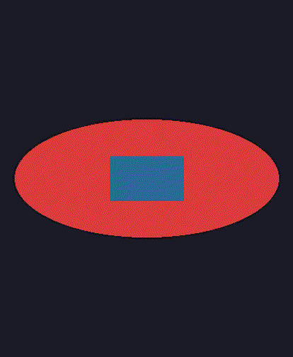

# Vorgan (Broken Rn fixing...)


A mouse-and-keyboard file manager for the terminal — now as a single Rust
binary. Its signature move is the **Graph** (press `Tab`): your current folder,
its folders and its archives as bubbles you click through like Obsidian's graph
view, with a physics layout, pinning and zoom. Everything from the python
version is here — same keys, same config, same state files — plus a few things
that only the native port can do:

- **Sixel image previews** — pictures fill the preview pane at the terminal's
  real pixel size, damage-tracked so they never flicker
- **Deep search** `F` — find files by name across every subfolder, open from
  the results menu
- **Undo** `u` — brings back the last trashed or moved item through an undo
  journal
- **Progress bars** — big copies, trashes, extracts and searches show a bar in
  the status line as they run
- A livelier graph: bubbles drift with the particle system from
  [vizr](https://pypi.org/project/vizr/), dots stream along the edges, and
  hovering a bubble lights its neighbourhood
- One ~10 MB binary, no python, no pip



The Graph:



New in 0.2.1 (rendered from the app's own output, hovering a bubble dims the rest and
lights its links; bright packets stream along the edges):



Image previews are fitted without stretching and sit on the pane's own colour
(this is the exact sixel the app sends, decoded):



Made on Arch + Hyprland + fish with the Caelestia palette, but it runs in any
terminal with mouse support, and it reads its colours live from whatever rice
you point it at.

## Install

Vorgan is one Rust binary. You need a Rust toolchain to build it and `bsdtar`
(libarchive) at runtime for archive folders.

### 1. Prerequisites

| Distro | Command |
|---|---|
| Arch | `sudo pacman -S --needed rust libarchive git` (or `rustup`) |
| Debian / Ubuntu | `sudo apt install git libarchive-tools build-essential` + [rustup.rs](https://rustup.rs) (distro `rustc` is often too old; **Rust 1.86+** is needed) |
| Fedora | `sudo dnf install git bsdtar gcc` + [rustup.rs](https://rustup.rs) |

Check with `rustc --version` (1.86 or newer).

### 2. Clone and build

```bash
git clone https://github.com/exotic-erox/Vorgan-Rust.git
cd Vorgan-Rust
cargo build --release      # first build downloads crates, takes a minute
cargo test --release       # optional: 19 tests
```

### 3. Install

Pick one:

```bash
cargo install --path .                                   # -> ~/.cargo/bin/vorgan
# or
sudo install -Dm755 target/release/vorgan /usr/local/bin/vorgan
# or, on Arch, as a real package (builds, tests, installs /usr/bin/vorgan)
makepkg -si
```

With `cargo install`, make sure `~/.cargo/bin` is on your `PATH`
(rustup does this for you). Then run `vorgan ~/Documents`, or `vorgan`
inside a folder.

### Update / uninstall

```bash
git pull && cargo install --path . --force    # update
cargo uninstall vorgan                         # remove
```

### Quit and cd

`q` quits and is meant to drop your **shell** into the folder you ended in —
the terminal itself cannot do that, so the launcher function does. Fish users
copy it in once:

```bash
mkdir -p ~/.config/fish/functions
cp shell/vg.fish ~/.config/fish/functions/vg.fish
```

and run `vg` from then on. For bash/zsh, put this in your `~/.bashrc` or
`~/.zshrc`:

```bash
vorgan() {
    local tmp="$(mktemp)"
    command vorgan --cwd-file="$tmp" "$@"
    if [ -s "$tmp" ]; then
        local dir; read -r dir < "$tmp"
        [ -d "$dir" ] && [ "$dir" != "$PWD" ] && cd "$dir"
    fi
    command rm -f -- "$tmp"
}
```

`Q` (or `ctrl+q`) quits without moving the shell.

## Files, previews, the Graph and everything else

Everything works with the mouse (click, double-click, ctrl/shift click, drag
onto a folder to move, right-click menus, toolbar) and with the keyboard. The
full keybind list lives in [docs/KEYBINDS.md](docs/KEYBINDS.md); this is the
daily bread:

| Key | Action |
|---|---|
| `j k h l` / arrows | Move, open, up |
| `f` | Hint tags: type the tag to jump to any visible item |
| `m` + letter, `'` + letter | Pin the current folder, jump back to it |
| `/` | Live filter, `.` hidden files, `s` sort |
| `space`, `ctrl+a` | Select |
| `y x p` | Copy, cut, paste |
| `r`, `a`, `A`, `d`, `D` | Rename, new folder, new file, trash, delete forever |
| `e`, `z` | Extract (here or to a path), compress (name, format, path, optional zip password) |
| `F` | Search every subfolder below you for a name |
| `u` | Undo the last trash / move |
| `~` | Frequent folders from your fish history |
| drag a pane edge | Resize the three panes (click to save; remembered across runs) |
| mouse wheel | Scrolls the list or the preview under the pointer (cursor stays put) |
| `t` | Open a terminal here |
| `q` / `Q` | Quit and cd / quit |

### Image previews

Select a picture and the preview pane paints it as sixels — the terminal's
true pixels, not half-block approximations. Adding files or scrolling reuses
the drawn image until the pane or the file actually changes. Needs a sixel
terminal (foot 1.20+ is what it is developed against); in anything else you
get text and metadata previews instead.

### The Graph (Tab)

| Do this | What happens |
|---|---|
| Click a bubble | Dive into that folder. The graph re-centres and shows its folders. |
| Click the centre bubble | Close the graph and go to that folder. |
| Click the dim up-arrow bubble | Go up one level. |
| Drag a bubble close to the centre | Pin it there (gold dotted ring). Pins are remembered. |
| Right-click a pinned bubble | Unpin it. |
| Mouse wheel / `+` `-` | Zoom. |
| Hover a bubble | Highlights its links, shows the names of its folders. |
| `+N more` bubble | Next page when a folder has many subfolders. |

Zip, tar, 7z and other archives show up as purple bubbles you can dive into
like folders. The bubbles never sit still entirely — they breathe with the
vizr particles, and physics goes to sleep when the graph settles.

## Configuration

`~/.config/vorgan/config.toml` (optional):

```toml
icons = "nerd"          # or "plain" if your font has no Nerd glyphs
show_hidden = false
sort = "name"           # name | size | date | type
archive_format = "zip"  # zip | tar.gz | tar.zst | tar.xz | 7z
graph_max_nodes = 28

[keys]
graph = "g"             # remap any action; see docs/KEYBINDS.md for all names
```

## Files it uses

| Path | Purpose |
|---|---|
| `~/.config/vorgan/config.toml` | Settings and key remaps (optional) |
| `~/.local/state/vorgan/` | Graph pins (`pins.json`), letter anchors (`anchors.json`), pane widths (`cols.json`), undo journal (`undo.json`) |
| `~/.local/state/caelestia/scheme.json` | Read-only: colours, re-read live (see docs/THEME.md) |

These are the same paths the python version reads — your pins, anchors and
column widths carry over untouched. No scheme file means the built-in dark
palette.

## Requirements

Rust to build, then at runtime: `libarchive` (bsdtar), a terminal with mouse
support (foot is what it is developed against), a Nerd Font for icons
(`icons = "plain"` otherwise). Optional: `wl-clipboard` (copy path),
`xdg-utils` (open files), and a sixel-capable terminal for image previews.

## Development

```
cargo test
cargo fmt
```

More docs: [KEYBINDS](docs/KEYBINDS.md) · [THEME](docs/THEME.md)

## License

MIT — see [LICENSE](LICENSE).

## Social

[](https://pypi.org/project/vizr/)
[](https://github.com/exotic-erox/vizr)
[](https://discord.com/users/1515183303995560096)
